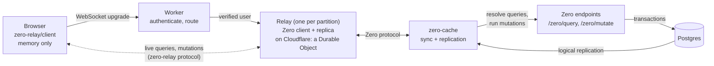
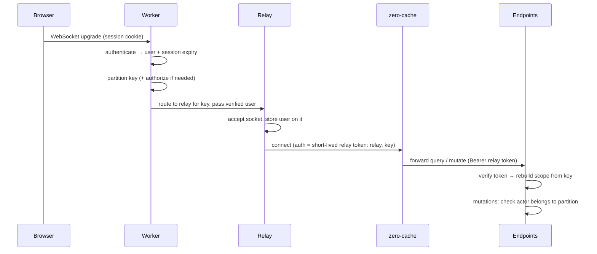

# zero-relay: design

A framework for apps that can't keep synced data on the device. It runs [Zero](https://zero.rocicorp.dev) clients on the server, one per **partition** (a user, a tenant, a resource), and serves their live data to thin browser clients. You write business logic: who the user is, what they may see, and what they may change. The framework owns the WebSockets, routing, server-side Zero clients, tokens, and Zero endpoints.

Status: design and implementation notes; see the [README](../README.md#status) and roadmap below for current coverage and remaining work. Based on Zero 1.11 (`@rocicorp/zero@1.11.3`), Effect 4 (`effect@4.0.6`), and the [hello-zero-cf](https://github.com/rocicorp/hello-zero-cf) sample. The router and builder API is inspired by [oRPC](https://orpc.dev) but doesn't depend on it. Cloudflare Durable Objects are currently the only recommended host and the only implemented adapter. For all non-Cloudflare hosts, the next planned deployment path is Node.js + Rivet. See [hosting](hosting.md).

---

## 1. Why this exists

Zero normally keeps a replica of synced data in the browser (IndexedDB, or memory with `kvStore: 'mem'`). Some apps can't allow that. The motivating case is healthcare: PHI may be shown in the browser but must not be stored on the device. Others include regulated finance data, shared kiosks, and very thin clients.

Zero's client also runs on the server. hello-zero-cf runs it in a Durable Object. If a server-side process is the Zero client, it holds the replica, and browsers subscribe to it over a WebSocket. This doc calls that process a **relay**.

Doing this by hand means writing a lot of infrastructure around every feature: socket handling, routing users to the right relay, sharing live views between connections, carrying identity across three hops, mapping errors, cleaning up idle relays. This framework makes all of that the framework's job, so app code reads like Zero code plus permissions.

---

## 2. What you write

The code in this section is excerpted from [`examples/todo/`](../examples/todo): a todo app where users have lists and can share them with each other. It typechecks against the package's real signatures in [`src/`](../src). The relay, endpoints, and socket client are implemented; the [source map](../src/README.md) describes their boundaries. [`tests/types.test.ts`](../tests/types.test.ts) shows what the API refuses to compile.

### 2.1 Who the user is, and which relay serves them

```ts
// app.ts
import { createApp } from "zero-relay";

export type User = {
  readonly userID: string;
  readonly name: string;
};

export const app = createApp<{ user: User; env: Env }>()({
  schema,

  // Who is making this request? Return null to reject it.
  authenticate: async ({ request, env }) => {
    const session = await getSession(request, env);
    if (!session) return null;
    const user = await loadUser(env, session.userID);
    return user ? { user, expiresAt: session.expiresAt } : null;
  },

  // Each user gets their own relay, which syncs as that user.
  partition: {
    key: ({ user }) => user.userID,
    authorize: ({ user, key }) => user.userID === key,
    scope: ({ key, env }) => loadUser(env, key),
    user: ({ scope }) => scope,
  },
});
```

The first call fixes the `User` and `Env` types; the second infers everything else, including the callbacks' parameter types and the relay's scope type. The partition is app code: the library has no built-in notion of users, tenants, or documents (section 5).

### 2.2 Permissions

```ts
// permissions.ts
import type { ExpressionFactory } from "@rocicorp/zero";

/** Lists the user owns or was added to. Use it in every query and mutation lookup on `list`. */
export const canSeeList =
  (user: User): ExpressionFactory<"list", typeof schema> =>
  (eb) =>
    eb.or(
      eb.cmp("ownerID", user.userID),
      eb.exists("members", (member) => member.where("userID", user.userID)),
    );
```

This is plain Zero, not a framework API: a reusable `where` condition, as in [Zero's permission patterns](https://zero.rocicorp.dev/docs/auth#permission-patterns). Procedures apply it where they query, so each procedure shows its own filter. Because it's ZQL, it stays live: sharing a list makes it appear for the new member without any refresh.

### 2.3 Queries and mutations

```ts
// router.ts
export const router = app.router({
  lists: {
    mine: app.query
      .output(z.object({ id: z.string(), name: z.string() })) // the only fields that leave the relay
      .handler(({ zql, user }) => zql.list.where(canSeeList(user)).orderBy("name", "asc")),

    get: app.query.input(z.object({ id: z.string() })).handler(({ zql, input, user }) =>
      zql.list
        .where("id", input.id)
        .where(canSeeList(user))
        .related("todos", (todos) => todos.orderBy("createdAt", "asc"))
        .one(),
    ),

    share: app.mutation
      .input(z.object({ listID: z.string(), userID: z.string() }))
      .errors({ NOT_FOUND: { message: "List not found" } })
      .handler(async ({ tx, zql, input, user, errors }) => {
        const list = await tx.run(
          zql.list.where("id", input.listID).where("ownerID", user.userID).one(),
        );
        if (!list) throw errors.NOT_FOUND();
        await tx.mutate.listMember.insert({ listID: input.listID, userID: input.userID });
      }),
  },

  todos: {
    add: app.mutation
      .input(z.object({ id: z.string(), listID: z.string(), title: z.string().min(1) }))
      .errors({ NOT_FOUND: { message: "List not found" } })
      .handler(async ({ tx, zql, input, user, errors }) => {
        const list = await tx.run(zql.list.where("id", input.listID).where(canSeeList(user)).one());
        if (!list) throw errors.NOT_FOUND();
        await tx.mutate.todo.insert({ ...input, done: false, createdAt: Date.now() });
      }),

    toggle: app.mutation
      .input(z.object({ id: z.string(), done: z.boolean() }))
      .errors({ NOT_FOUND: { message: "Todo not found" } })
      .handler(async ({ tx, zql, input, user, errors }) => {
        const todo = await tx.run(
          zql.todo
            .where("id", input.id)
            .whereExists("list", (list) => list.where(canSeeList(user)))
            .one(),
        );
        if (!todo) throw errors.NOT_FOUND();
        await tx.mutate.todo.update({ id: input.id, done: input.done });
      }),
  },
});

export type Router = typeof router;
```

Query handlers are ordinary Zero query functions: synchronous, returning ZQL. Mutation handlers are ordinary Zero mutators: async, with a transaction. If you know Zero, you already know how to write these. Mutations check permissions the same way queries do: by looking the row up through `canSeeList` and failing with `NOT_FOUND` if it isn't visible.

### 2.4 Hosting

Cloudflare is currently the only recommended hosting platform. The example below uses its implemented adapter. For all other hosts, the planned path is Node.js + Rivet; see [hosting](hosting.md) for implementation status and requirements.

```ts
// worker.ts
import { zeroPostgresJS } from "@rocicorp/zero/server/adapters/postgresjs";
import { cloudflare } from "zero-relay/cloudflare";

const relay = cloudflare(app, {
  router,
  database: (env) => zeroPostgresJS(schema, env.DATABASE_URL),
});

export const Relay = relay.DurableObject;

export default {
  async fetch(request: Request, env: Env, ctx: ExecutionContextLike): Promise<Response> {
    return (await relay.handle(request, env, ctx)) ?? new Response("Not found", { status: 404 });
  },
};
```

Plus configuration: a Durable Object binding named `RELAY` for the `Relay` class, and the `ZERO_CACHE_URL`, `ZERO_RELAY_SECRET`, and `DATABASE_URL` variables. Point zero-cache's `ZERO_QUERY_URL` and `ZERO_MUTATE_URL` at `/zero/query` and `/zero/mutate` on this Worker. `relay.handle` returns `undefined` for paths it doesn't own, so the Worker's other routes go in the same `fetch`. A Worker with no other routes can `export default relay.worker` instead.

The Worker's env type can be wider than the app's: the app declares what its own code reads (here, `SESSION_SECRET`), and the host adds its bindings. Annotating `database`'s parameter is enough for `cloudflare()` to type everything else against the host's env.

**With Alchemy.** [`examples/todo-alchemy/`](../examples/todo-alchemy) runs the same app with [Alchemy](https://alchemy.run). `alchemy dev` starts a local Postgres 17 container (logical replication on, seeded from `migrations/` and `dev/seed.sql`), zero-cache as a container, and one Worker that serves the React app, the relay endpoints, and the `Relay` Durable Object. Hyperdrive's binding points at that local Postgres. The Worker's env type is inferred from `alchemy.run.ts`, so bindings can't drift from the infrastructure. The relay reaches zero-cache through the container's Durable Object stub rather than a public URL:

```ts
const relay = cloudflare(app, {
  router,
  database: (env: WorkerEnv) => zeroPostgresJS(schema, env.HYPERDRIVE.connectionString),
  cache: (env) => getContainer(env.ZERO_CACHE),
});
```

### 2.5 The browser

```ts
// web/api.ts
import { createClient } from "zero-relay/client";
import type { Router } from "../router.ts";

export const api = createClient<Router>(); // connects to /zero/live when first used
```

```tsx
// web/TodoList.tsx
export function TodoList({ listID }: { listID: string }) {
  const [list, { status, error: queryError }] = useQuery(api.lists.get, { id: listID });
  const { mutate: add, pending, error: addError } = useMutation(api.todos.add);
  const { mutate: toggle, error: toggleError } = useMutation(api.todos.toggle);
  const [title, setTitle] = useState("");
  const mutationError = addError ?? toggleError;

  if (queryError) return <p role="alert">{queryError.message}</p>;
  if (!list) return status === "complete" ? <p>List not found.</p> : <p>Loading…</p>;

  const addTodo = async () => {
    const { error } = await add({ id: crypto.randomUUID(), listID, title });
    if (!error) setTitle("");
  };

  // ...renders list.name, checkboxes that call toggle(), and mutationError?.message
}
```

`useQuery` returns `[data, { status, error }]`: show a spinner while `status` is `'unknown'`, and "not found" only once it's `'complete'`. On failure, `status` is `'error'` and `error` describes the problem. `list` is typed from the handler's ZQL and `.one()`: the list row with its `todos`, or `undefined`. Mutation `error.code` is the declared `NOT_FOUND` or one of the built-in codes. The todo's `id` comes from the browser, as in any Zero app, so the relay's optimistic run and the server's run write the same row.

Components consume query data and mutation state directly. They can display the framework's error messages without handling transport error codes themselves. Optional procedure inputs may be omitted (`useQuery(api.search)`), and schema defaults still apply. An explicit `null` remains distinct from an omitted argument, both when React decides to resubscribe and when the relay shares query views.

### 2.6 What you never write

WebSocket handlers, Durable Object classes, routing, relay tokens, Zero client setup, `defineQueries` and `defineMutators` registries, the query and mutate endpoints, identity plumbing between hops, view sharing and cleanup, reconnection, or error serialization.

---

## 3. What the framework generates



From your five files, the framework produces:

| Generated piece      | Built from                          | Does                                                                                                                               |
| -------------------- | ----------------------------------- | ---------------------------------------------------------------------------------------------------------------------------------- |
| Worker `fetch`       | `authenticate`, `partition`         | Authenticates WebSocket upgrades, picks the relay for the user's partition key, and forwards the verified user and session expiry. |
| Relay Durable Object | `router`, `schema`, `partition`     | Runs a Zero client for its partition, serves live queries and mutations, shares views, emits audit events.                         |
| Zero registries      | Query and mutation handlers         | The `defineQueries` and `defineMutators` registries used by the relay's Zero client and the endpoints.                             |
| Zero endpoints       | Registries, `partition`, `database` | Verify the relay's token, rebuild the user, check guards, and run handlers.                                                        |
| Browser client       | `Router` type only                  | Typed calls and subscriptions over one WebSocket, with reconnect.                                                                  |

The rest of this doc explains how those pieces work and why they're shaped this way.

---

## 4. Architecture primer

There are five runtime pieces. Compared with standard Zero, the browser doesn't run Zero at all.

| Piece      | Role                                                                                                                                                        | Holds synced data?                               |
| ---------- | ----------------------------------------------------------------------------------------------------------------------------------------------------------- | ------------------------------------------------ |
| Postgres   | Source of truth.                                                                                                                                            | Yes                                              |
| zero-cache | Replicates Postgres into its own SQLite replica, runs synced queries, streams row changes to Zero clients, forwards queries and mutations to the endpoints. | Yes                                              |
| Endpoints  | `/zero/query` turns a query name and args into ZQL. `/zero/mutate` runs mutations in a Postgres transaction. Both run handlers with the relay's identity.   | Transiently                                      |
| Relay      | Runs a Zero client for one partition, keeps its replica (in memory or host storage), and serves browser connections.                                        | Yes                                              |
| Browser    | Renders. Talks only to its relay. Keeps state in memory only.                                                                                               | In memory only, and only what `.output()` allows |

### A read, end to end

1. The component calls `useQuery(api.lists.get, { id })`. The client sends a `sub` message over the relay's WebSocket (section 9).
2. The relay checks guards, emits a `subscribe` audit event, and looks up a shared view for `lists.get` with these args, creating it if needed: `zero.materialize(queries.lists.get(args))`.
3. Zero runs the query function in the relay against its local replica and returns what it already has (`resultType: 'unknown'`).
4. In the background, Zero sends the query name and args to zero-cache, which calls `/zero/query`. The endpoint verifies the relay, rebuilds its user, runs the handler (row filters included), and returns ZQL.
5. zero-cache runs the ZQL and sends rows to the relay. The view updates (`resultType: 'complete'`).
6. Each update is projected through `.output()`, audited, and pushed to the browser as a `data` message.
7. Later Postgres changes flow through logical replication, then zero-cache, then the relay, then the browser.

### A write, end to end

1. The browser calls `api.todos.toggle(input)`, which sends a `call` message.
2. The relay checks guards and emits an audit event.
3. The relay calls `zero.mutate(...)`, tagging the mutation with the acting user (the **actor**, section 5.4). The handler runs optimistically against the relay's replica, so every live view in that relay updates within one round trip.
4. Zero pushes the mutation to zero-cache, which calls `/zero/mutate`. The endpoint re-checks guards with the actor and runs the same handler in a Postgres transaction.
5. If the server rejects it, Zero rolls back the optimistic change in the relay, and the views update again.
6. The browser's call resolves with the server's result: data, or a typed error.

---

## 5. Partitioning

A **partition** decides which relay a browser connection talks to, and so which data that relay holds and under whose identity it syncs. The framework makes no assumptions about how an app is partitioned. It identifies each relay by a string key, and the app supplies the functions that give the key meaning:

```ts
partition: {
  key: ({ user, request, url, env }) => string | null,
  authorize: ({ user, key, env }) => boolean,
  scope: ({ key, env }) => Scope | null,
  user?: ({ scope }) => User,
}
```

| Function    | Answers                                            | Runs                                                                                         |
| ----------- | -------------------------------------------------- | -------------------------------------------------------------------------------------------- |
| `key`       | Which relay serves this connection?                | In the host router, on WebSocket upgrade                                                     |
| `authorize` | May this user use the relay for this key?          | On upgrade, and at the endpoint for every mutation's actor                                   |
| `scope`     | What does the relay's Zero client sync as?         | In the relay at startup and on refresh (section 6.5), and in the endpoints for every request |
| `user`      | Optional. Who is the one person this relay serves? | In the endpoints, after `scope`                                                              |

`authorize` can't be derived from `key`, because the endpoint checks each mutation's actor without a request to compute a key from. All of these may be async.

### 5.1 Two identities

Every relay deals with two identities:

- **The user** (`user` in your code): the person on a particular socket, from the session returned by `authenticate`. There may be many per relay.
- **The scope** (`scope` in your code): the identity the relay's Zero client syncs under, as returned by `partition.scope`. There's one per relay, fixed for its lifetime, and it **depends only on the key**, never on which user happened to connect first. That's what lets the endpoints rebuild it from the key in the relay's token instead of trusting claims.

`partition.user` states one more fact: every connection to a relay is the same person, and here's how to get them from the scope. That's the only thing the framework needs to know about an app's partitioning to decide where checks run (section 6). With it, the server knows the user, so query handlers can filter by user. Without it, the relay is **shared**, and queries can only filter by scope.

### 5.2 Examples

These are app code, not library exports.

```ts
// One relay per user. Single-user: query handlers can filter by user.
partition: {
  key: ({ user }) => user.userID,
  authorize: ({ user, key }) => user.userID === key,
  scope: ({ key, env }) => loadUser(env, key),
  user: ({ scope }) => scope,
},

// One relay per team. Shared.
partition: {
  key: ({ user }) => user.teamID,
  authorize: ({ user, key }) => user.teamID === key,
  scope: ({ key }) => ({ teamID: key }),
},

// One relay per list the client opens, e.g. /zero/live?listID=l1. Shared.
partition: {
  key: ({ url }) => url.searchParams.get("listID"),
  authorize: ({ user, key, env }) => isListMember(env, user.userID, key),
  scope: ({ key }) => ({ listID: key }),
},
```

### 5.3 Single-user or shared

|                            | Single-user (`user` defined)                                    | Shared                                                                            |
| -------------------------- | --------------------------------------------------------------- | --------------------------------------------------------------------------------- |
| Row filters                | By user, enforced by the server                                 | By scope only (section 6.2)                                                       |
| Data held per relay        | Only what one user may see                                      | Everything the scope may see                                                      |
| Relay memory               | Small                                                           | Grows with the scope. Cloudflare isolates have a memory cap (128 MB, to confirm). |
| Sync duplication           | Shared records are synced once per user (same as standard Zero) | Synced once per scope                                                             |
| Collaboration and presence | Needs a separate shared relay                                   | Natural                                                                           |
| Connections to zero-cache  | One per active user                                             | One per active scope                                                              |

Recommendation: **single-user partitions for sensitive data.** Row filters run in two places (relay and server), Zero's documented permission patterns apply unchanged, and memory stays bounded. Use shared partitions where scope-level server enforcement is enough, or for collaboration relays with no sensitive data.

### 5.4 Writes carry the actor

The endpoints need to know who performed a write, both to check guards and to attribute the change. The framework wraps each mutation's args in an envelope, `{ input, actor }`, where `actor` is the verified user from the relay's socket, never from the browser. Zero persists args with the mutation, so the actor survives rebases and retries.

At the endpoint, before running the handler, the framework calls `partition.authorize({ user: actor, key })` to check that the actor may act in this relay. Your handler sees the actor as `user`.

The endpoint can trust the actor because only relays hold credentials for zero-cache, and zero-cache isn't reachable by browsers (section 11.2). Relays can also sign actor claims with a key only the endpoints verify, as optional hardening against a compromised zero-cache.

### 5.5 Multiple relays per app

An app can host several relays, each with its own partition and router. For example: a per-user relay for lists, and a per-document relay for collaborative editing with presence.

```ts
// Same schema, auth, and audit; different partition. Its builders know the new scope.
export const docApp = app.withPartition({
  key: ({ url }) => url.searchParams.get("docID"),
  authorize: ({ user, key, env }) => canEditDoc(env, user.userID, key),
  scope: ({ key }) => ({ docID: key }),
});

export const docRouter = docApp.router({/* docApp.query..., docApp.mutation... */});

const relay = cloudflare(app, {
  router, // default relay, uses app's partition
  relays: { doc: { app: docApp, router: docRouter } },
});
```

Each relay gets its own Zero client, token scope, and route (`/zero/live/doc`). The endpoints serve all of them: the token names the relay, and the endpoint uses that relay's partition to rebuild the scope.

---

## 6. Access control

There are two kinds of check, and they answer different questions:

- **A guard** decides whether the user may call a procedure at all. It looks at the user (and optionally the input), never at rows, and fails with `FORBIDDEN`.
- **A row filter** decides which rows the user may see or change. It's ordinary ZQL in the procedure's handler, as in Zero. Rows the user can't see are simply absent.

### 6.1 Guards

For an app whose users have a role:

```ts
const admins = app.guard(({ user }) => user.role === "admin", { name: "admins" });

deleteUser: app.mutation.use(admins).input(/* ... */).handler(/* ... */),
```

Guards are **synchronous** functions of the user and, optionally, the input. They have to be: Zero calls query functions synchronously on the server, so an async check can't run there. Checks that need data ("is this user a member of the list?") are row filters, written as ZQL.

| Guard on a… | In the relay                                       | At the server endpoint                                                                                                                   |
| ----------- | -------------------------------------------------- | ---------------------------------------------------------------------------------------------------------------------------------------- |
| Query       | Rejects the subscription with a `FORBIDDEN` error. | Single-user partitions: the query fails with `FORBIDDEN`, which ends the subscription. Shared: not enforceable (the server has no user). |
| Mutation    | Rejects the call with a `FORBIDDEN` error.         | Re-checked with the actor. A failure skips the mutation and rolls back the optimistic change.                                            |

### 6.2 Row filters

Row filters are written in the handler, where the query is, so each procedure shows exactly what it returns. To reuse one, export a condition, like `canSeeList` in section 2.2, and apply it with `.where()`. A condition is typed to its table, so applying `canSeeList` to a `todo` query doesn't compile.

- **Queries:** the filter is part of the registered Zero query, so it runs both in the relay's Zero client and at the server endpoint. The server's run is authoritative, as in standard Zero.
- **Mutations:** look the row up through the same condition with `tx.run`, and fail if it isn't there (`todos.toggle` in section 2.3). Mutations run in the relay and again at the server, so the server's check is authoritative here too.
- **Related rows:** a filter on the root table doesn't filter rows pulled in with `.related()`. If related rows need their own permission check, filter them inside the `.related()` subquery.

**Shared partitions.** In a shared relay, the server doesn't know which user is on which socket (section 5.3), so query handlers receive `scope` instead of `user` and can only filter by scope (`zql.todo.where("listID", scope.listID)`). Every connection to that relay sees the same rows. Filtering per user within a shared relay would need a second filter that runs only in the relay, over what's already synced. That's an open design question (section 15). Until then, put per-user boundaries in the partition: anyone who passes `partition.authorize` sees everything the relay syncs.

### 6.3 Output projection

`.output(schema)` declares the fields a query sends to the browser. The relay projects every update through it before it leaves the relay. For sensitive data, this is minimization by default: a field you didn't list never reaches the browser, even if the query synced it.

### 6.4 Audit

The framework emits access events to your `audit.sink`; you decide where they're stored.

| Event         | When                                             | Includes                              |
| ------------- | ------------------------------------------------ | ------------------------------------- |
| `subscribe`   | A browser subscribes to a query                  | User, path, input                     |
| `deliver`     | An update is sent (optional, `audit.deliveries`) | User, path, IDs of the root rows sent |
| `unsubscribe` | A subscription ends                              | User, path, duration                  |
| `mutate`      | A mutation is called, and again when it settles  | User, path, input, outcome            |
| `denied`      | A guard rejects a subscription or call           | User, path, which guard               |

Audit rows that must be atomic with a write (in the same transaction) are written in the mutation handler or a mutation middleware (section 7.3).

### 6.5 Context refresh and revocation

Guards and row filters read the user and scope, which are loaded asynchronously by `authenticate` and `partition.scope`. Loaded values don't change on their own: if an admin changes someone's role, a relay that loaded the old role keeps using it until it reloads. Row filters written as ZQL against data, like `canSeeList`'s `exists`, don't have this problem: Zero re-evaluates them as rows change. Context refresh covers everything else.

**Triggers:**

- **`invalidate({ key })` in a mutation handler.** Runs after the transaction commits. It's discarded if the mutation fails or is retried, and ignored in the relay's optimistic run.
- **`relay.invalidate(env, { key })` from anywhere in the Worker.** For admin tools, identity-provider webhooks, and SCIM sync.
- **A refresh interval** (`refreshInterval`, default 5 minutes). It catches changes made outside the app, like a direct database edit. It matches zero-cache's `ZERO_AUTH_RETRANSFORM_INTERVAL_SECONDS`, which is how often zero-cache re-runs queries through the endpoints anyway.

For an app whose `partition.scope` loads the user's role:

```ts
setRole: app.mutation
  .use(admins)
  .input(z.object({ userID: z.string(), role: z.enum(["admin", "member"]) }))
  .handler(async ({ tx, input, invalidate }) => {
    await tx.mutate.user.update({ id: input.userID, role: input.role });
    invalidate({ key: input.userID });
  }),
```

**What a refresh does, in the relay for that key:**

1. Re-runs `partition.scope({ key })`. If it returns `null`, access is revoked: the relay sends `close` with reason `revoked` to every socket, closes its Zero client, and drops its data. The browser client stops reconnecting.
2. Mints a fresh relay token and calls `zero.connection.connect({ auth })`. Zero documents that this, while connected, "refreshes server-side auth context and re-transforms queries without reconnecting". zero-cache calls the query endpoint for every active query, the endpoint rebuilds the scope from the database, and the new results flow to browsers as ordinary updates.
3. Re-checks guards for every open subscription. Ones that now fail get an `error` with `FORBIDDEN`, are closed, and emit a `denied` audit event.
4. In shared partitions, each socket's user came from `authenticate`, which needs the browser's request. On both the refresh interval and an explicit invalidation, the relay sends `close` with reason `refresh`. The client reconnects through the Worker's `authenticate` and `partition.authorize` checks, then resubscribes if still allowed. This reloads membership and roles instead of checking a stale user object, at the cost of a brief reconnect every `refreshInterval` (five minutes by default). Shared sockets also reconnect if loading the scope fails, so a failed scope refresh cannot keep their old credentials valid indefinitely. A `needs-auth` refresh only renews Zero's credentials; the regular interval still bounds browser reauthentication. Single-user sockets keep their connection while the relay refreshes their user and guards in place.

How long a change can take to apply:

| How the change happens                  | Applies within                         |
| --------------------------------------- | -------------------------------------- |
| ZQL-checked data (list membership)      | Immediately, as a normal live update   |
| A mutation that calls `invalidate`      | About one round trip after commit      |
| A webhook that calls `relay.invalidate` | About one round trip after the webhook |
| Anything else (direct database edit)    | `refreshInterval` (default 5 minutes)  |

`authenticate` returns `{ user, expiresAt }`, or `null` to reject the upgrade. `expiresAt` is the verified session's absolute Unix timestamp in milliseconds; an explicit `null` opts into a session with no expiry. Missing, invalid, and elapsed deadlines are rejected. The Worker forwards this deadline separately from the user, overwriting any browser-supplied value, and the relay closes that socket with `session-expired` when it expires. Other sessions in the same relay keep their own deadlines. Refreshing a user's roles or renewing Zero's relay token never extends a browser session.

The relay checks expiry before handling messages, delivering data, and starting mutations after asynchronous checks, as well as using a timer to close idle sockets. Work already submitted to Zero can still commit; a caller awaiting its result receives `OUTCOME_UNKNOWN` when the socket closes. The browser clears its data and stops reconnecting. After obtaining a new session, create a new client. The todo example signs the session's user and expiry together; its development sessions last one hour.

---

## 7. Queries, mutations, and errors

### 7.1 Builders

Builders are immutable, as in oRPC: every method returns a new builder, so partial builders can be shared.

| Method              | `app.query` | `app.mutation` | Purpose                                                                      |
| ------------------- | ----------- | -------------- | ---------------------------------------------------------------------------- |
| `.input(schema)`    | Yes         | Yes            | Validates args. Any Standard Schema validator (Zod, Valibot, Effect Schema). |
| `.use(guard \| mw)` | Yes         | Yes            | Adds guards and middleware, run in declared order.                           |
| `.output(schema)`   | Yes         |                | Fields sent to the browser (section 6.3).                                    |
| `.errors({...})`    |             | Yes            | Declares typed errors.                                                       |
| `.meta({...})`      | Yes         | Yes            | Queries: `ttl`, `audit`. Mutations: `ack`, `audit`.                          |
| `.handler(fn)`      | Yes         | Yes            | The business logic. Ends the chain.                                          |

`app.router({...})` takes a plain nested object. Paths become Zero names (`todos.toggle`) and client paths (`api.todos.toggle`).

Handler arguments:

| Argument      | Queries                     | Mutations                                                    |
| ------------- | --------------------------- | ------------------------------------------------------------ |
| `input`       | Validated input             | Validated input                                              |
| `zql`         | Zero's query builder        | Zero's query builder                                         |
| `user`        | Single-user partitions only | The actor, always                                            |
| `scope`       | The relay's scope           | The relay's scope                                            |
| `tx`          |                             | Zero's transaction                                           |
| `location`    |                             | `"relay"` (optimistic run) or `"server"` (authoritative run) |
| `errors`      | Typed error constructors    | Typed error constructors                                     |
| `afterCommit` |                             | Server only: run a task after the transaction commits        |
| `invalidate`  |                             | Server only: refresh a relay's context after commit (6.5)    |

### 7.2 Errors

```ts
.errors({ NOT_FOUND: { message: "Todo not found" } })
// in the handler:
throw errors.NOT_FOUND();
```

For structured errors, declare `.errors({ CONFLICT: { data: z.object({ version: z.number() }) } })` and `throw errors.CONFLICT({ version })`. Constructors accept the schema's input type; the client receives its output type. Validation, including async validators and transforms, happens inside the framework before serialization. The transformed output is forwarded without applying the input schema again at the next hop. Invalid data, validator failures, and non-JSON output become generic `INTERNAL` errors. Errors without a data schema omit data, while an explicit schema-validated `null` stays `null`. Undeclared custom codes are hidden. These rules also cover errors raised by mutation middleware.

In the browser, a call either throws a typed `RelayError` or, with `.safe(input)`, returns `{ data, error }`. `error.code` is a union of the declared codes plus the built-ins `FORBIDDEN`, `UNAVAILABLE`, `BAD_INPUT`, `DISCONNECTED`, `OUTCOME_UNKNOWN`, and `INTERNAL`. For mutations, `DISCONNECTED` means the client ended before sending the call; `OUTCOME_UNKNOWN` means sending was attempted but no result arrived, so the write may have committed. Reconcile with current data before retrying an unknown outcome.

Each hop carries the error:

- At the server, the framework encodes declared errors in Zero's `ApplicationError` `details`. Zero delivers them to the relay as `{ type: 'app', message, details }`.
- The relay decodes them and sends them to the browser as `result` messages with the code and data.
- Unknown errors become `INTERNAL` with the message hidden.

Sensitive data must never appear in an error message or data, because both reach the browser and the logs.

### 7.3 Middleware (escape hatch)

Guards, row filters, output projection, and audit cover most needs. For anything else, there are three middleware kinds, matching the three places code runs:

| Kind                      | Runs                                                                           | Async? | Sees                                  | Example uses                                         |
| ------------------------- | ------------------------------------------------------------------------------ | ------ | ------------------------------------- | ---------------------------------------------------- |
| `app.middleware.relay`    | In the relay, handling a browser subscription or call                          | Yes    | User, input, delivered data           | Rate limits, redaction, custom audit                 |
| `app.middleware.query`    | Inside the Zero query function, in the relay's Zero client and at the endpoint | No     | Scope, user (single-user), input, ZQL | Filters that aren't tied to one table                |
| `app.middleware.mutation` | Inside the Zero mutator, in the relay's Zero client and at the endpoint        | Yes    | Scope, actor, input, `tx`             | Audit rows in the same transaction, write validation |

Query and mutation middleware run at both sites by default; pass `{ on: "relay" }` or `{ on: "server" }` to restrict them. `"relay"` is the Zero client inside the relay, which Zero itself calls `'client'`.

```ts
export const auditLogger = app.middleware.mutation(
  async ({ tx, user, path, next }) => {
    const result = await next();
    await tx.mutate.auditLog.insert({
      id: crypto.randomUUID(),
      actorID: user.userID,
      action: path,
      at: Date.now(),
    });
    return result;
  },
  { on: "server" },
);
```

Why these constraints:

- Zero query functions are synchronous and return ZQL, not rows, on both client and server. Query middleware can only rewrite ZQL.
- Relay middleware is ordinary async code and sees materialized rows. Row-aware work (delivery audit, redaction) belongs there.
- The relay and the endpoints are both trusted server code, so code that runs in both doesn't need bundle-safety tricks.

---

## 8. Relay runtime

### 8.1 Live queries

Each subscription:

1. Runs guards and relay middleware, and emits a `subscribe` audit event.
2. Acquires a shared view keyed by `(path, args)`: `zero.materialize(queries.x(args))`. Concurrent subscribers share one view.
3. Turns view updates into snapshots with a query status (`unknown` or `complete`) and forwards errors separately. React exposes this as `status`, so the browser can avoid flashing "not found" while data loads.
4. Coalesces bursts, so a large replication batch becomes one message.
5. On unsubscribe or disconnect, releases its reference to the view. When the last reference is released, the view is destroyed after a one-second grace period, so a quick resubscribe (a reconnect) reuses it. `materialize` is called with `ttl: 'none'` unless the query sets `.meta({ ttl })`. Zero expires a query once every client has dropped it and that TTL has elapsed, then deletes the rows no other query still needs. `none` elapses immediately, so the rows a relay holds are the rows of its open views. That is the same bound a browser tab has: IndexedDB is not a byte-capped LRU, it is the working set of queries, and the browser's storage quota is only a hard failure behind that. A browser keeps Zero's five-minute default so a navigation back is instant. A relay's store is the Durable Object heap, shared with every other relay in the isolate, so idle queries do not get that retention. `.meta({ ttl })` opts one query back in, up to Zero's 10 minute clamp, for a resubscribe that should not wait on zero-cache. The view itself is still destroyed after one second either way.

Phase 0 sends full snapshots on each change, which is what `view.addListener` provides. Row-level diffs (Zero's custom `View` interface reports add, remove, and edit changes) come later if payload size matters.

### 8.2 Mutations

1. Guards and relay middleware run.
2. `const write = zero.mutate(mutators.x({ input, actor }))`.
3. `await write.client`. Zero doesn't send a mutation whose client run throws, so failures here split two ways:
   - Guards, input validation, and unexpected exceptions don't depend on synced data. They go straight back to the browser, and nothing reaches the server.
   - A declared error (`errors.NOT_FOUND()`) usually comes from a lookup, and the relay's replica holds only what its browsers subscribe to. A missing row there may just be unsynced. So in the relay's run the framework treats a declared error as "can't decide here": the run returns without throwing, and the server decides. Handlers stay written as in section 2.3, with no `location` checks.
4. By default, `await write.server` and return its result. The relay's views already show the optimistic change, so waiting doesn't hurt perceived latency much. `.meta({ ack: "relay" })` responds right after step 3 instead, unless the relay's run deferred to the server.
5. If the relay's Zero connection is down, Zero rejects writes, and the call returns `UNAVAILABLE`.

### 8.3 Lifecycle

| State   | What happens                                                                                                                                               |
| ------- | ---------------------------------------------------------------------------------------------------------------------------------------------------------- |
| Cold    | First connection arrives. The relay computes its scope from its key and creates its Zero client.                                                           |
| Active  | Zero holds an outbound WebSocket to zero-cache. Views are reference counted. The context refreshes on invalidation and on `refreshInterval` (section 6.5). |
| Idle    | The last connection closed. After a grace period, the relay destroys its views and calls `zero.close()`.                                                   |
| Evicted | The host evicts the idle relay. With `mem`, the replica is gone. With host storage, it stays until the retention timer wipes it.                           |

On Cloudflare, idle timers and retention use Durable Object alarms. Browser sockets can use the hibernation API, but I believe a Durable Object holding an **outbound** WebSocket (to zero-cache) stays in memory. While users are subscribed, the relay must be awake to push updates anyway, so hibernation only helps after the Zero connection closes. Needs verifying (section 15).

### 8.4 Where a relay's replica lives

- **`storage: "memory"` (the default).** `kvStore: 'mem'`. Nothing is persisted. Each cold start resyncs from zero-cache, and the rows sit in the isolate heap.
- **`storage: { sqlite: { retainFor } }`.** The same Zero key-value map, in the Durable Object's SQLite file. One table, `zero_relay_kv (store, key, value)`, one row per entry, `value` a JSON text. Named stores share the file and not their keys. Zero's own SQLite providers store this same map as `entry (key, value)` JSON text; one Durable Object file holds every named store, so the table adds a `store` column instead of a table per name. The app's tables stay in Postgres. On Workers Paid the file is 10 GB per object and does not count toward the isolate's 128 MB; a single entry is at most 2 MB, and a larger `put` fails before it is written. `SQLITE_FULL` is reported as Zero's storage-full failure. `retainFor` is how long the file survives after the Zero client goes idle: an alarm deletes it, and `0` deletes it immediately. A new session cancels the alarm. The class has to be created with `new_sqlite_classes`.
- The live view is still in the heap. SQLite holds the replica, not the rows of a query a browser is looking at.
- Zero's `Read` and `Write` interfaces are experimental. This adapter is pinned to Zero 1.11.3.

---

## 9. Wire protocol

The browser and relay speak a small JSON protocol over one WebSocket, owned by this framework.

**Why not reuse oRPC's transport:** Zero data is plain JSON, so oRPC's richer serializer buys nothing. Subscriptions here need specific semantics (Zero's result type, resubscribe-on-reconnect, coalescing) that are easier to own than to layer on. And the browser client stays small with no dependencies.

Browser to relay:

| Message                          | Meaning                                                 |
| -------------------------------- | ------------------------------------------------------- |
| `{ t: "sub", id, path, input }`  | Start a live query. `id` is chosen by the client.       |
| `{ t: "unsub", id }`             | Stop it.                                                |
| `{ t: "call", id, path, input }` | Run a mutation. `id` is a UUID, used for deduplication. |

Relay to browser:

| Message                                 | Meaning                                                                                                         |
| --------------------------------------- | --------------------------------------------------------------------------------------------------------------- |
| `{ t: "data", id, data, type }`         | Current result of subscription `id` (a snapshot in phase 0).                                                    |
| `{ t: "result", id, ok: true, data }`   | Mutation succeeded.                                                                                             |
| `{ t: "result", id, ok: false, error }` | Mutation failed. `error` is `{ code, message, data }`.                                                          |
| `{ t: "error", id, error }`             | Subscription failed and was closed.                                                                             |
| `{ t: "close", reason }`                | The relay is ending the session. `refresh` and `restarting`: reconnect. `revoked` and `session-expired`: don't. |

Details:

- The protocol version is negotiated with the WebSocket subprotocol header (`zero-relay.v1`).
- **Reconnect:** the client keeps its active subscriptions (paths and inputs, in memory) and re-sends them after reconnecting. The relay replies with fresh snapshots. No data is cached in the browser across the gap.
- **Clearing data:** disconnects notify subscription listeners with `{ data: undefined, status: "unknown" }` until fresh snapshots arrive. Terminal subscription errors (including `FORBIDDEN`), revocation, session expiry, and `$close()` notify with `{ data: undefined, status: "error" }` before calling `onError`. Revocation and expiry report `FORBIDDEN`; `$close()` reports `DISCONNECTED`. React's `useQuery` clears its stored snapshot on these notifications and on every terminal error. A client that has ended rejects new subscriptions immediately. Custom consumers must replace their displayed data with each snapshot, including empty ones, and clear any separately retained copies themselves.
- **Hidden tabs:** as in Zero, the client disconnects after its tab has been hidden for `hiddenTabDisconnectDelay` (default 5 minutes) and reports status `hidden`. When the tab is visible again, it reconnects and resubscribes like any other reconnect. Without this, a forgotten tab keeps its relay awake, because a relay with an open Zero connection can't hibernate.
- **Mutations across a disconnect:** calls that have never been sent stay queued until a connection opens. Once sending is attempted, the client never automatically replays the call. If the connection ends before a result arrives (including refreshes, hidden-tab disconnects, revocation, and logout), the call rejects with `OUTCOME_UNKNOWN`; `.safe()` returns that error. The write may have committed, so callers must reconcile with current data before retrying. When the client ends permanently, unsent calls reject with `DISCONNECTED`. The relay's short-lived, in-memory result cache only deduplicates repeated messages while an entry survives; it does not guarantee safe retries after expiration or restart. Reliable retries would require application-level idempotency recorded in the same transaction as the write.
- **Keepalive:** pings are answered by the host's auto-response (on Cloudflare, `setWebSocketAutoResponse`), so they don't wake a hibernated relay.
- Every incoming message is schema-validated before dispatch. Unknown paths and invalid input are rejected with `BAD_INPUT` before any handler runs.

---

## 10. Built with Effect, internally

The relay is a long-lived process juggling resources with different lifetimes: a Zero client, shared views, per-socket subscriptions, timers, and token refresh. That's what [Effect](https://effect.website) is good at. So the framework's runtime is written with Effect, while **app code never sees it**: handlers and guards are plain functions and promises, and the browser client doesn't include Effect.

| Concern in the relay                                         | Effect tool                                                                                                                   |
| ------------------------------------------------------------ | ----------------------------------------------------------------------------------------------------------------------------- |
| Relay services (Zero client, audit sink, env)                | `Context.Service` and `Layer`, one `ManagedRuntime` per relay instance                                                        |
| Zero client: connect on first use, close when idle           | `RcRef` with `idleTimeToLive` (the idle grace period), `Effect.acquireRelease`                                                |
| Shared views, destroyed one second after the last subscriber | `RcMap` keyed by `(path, args)`, `idleTimeToLive` of 1 second. Query TTL goes to `materialize`, default `none` (section 8.1). |
| Per-subscription work, cancelled on unsub or close           | `FiberMap` keyed by subscription ID. Interrupting a fiber releases its view reference.                                        |
| View updates to socket messages, with coalescing             | `Stream.callback` over `view.addListener`, then `Stream.debounce` or `Stream.groupedWithin`                                   |
| Token refresh, reconnect backoff                             | `Schedule.spaced`, `Schedule.exponential` with `Schedule.jittered`, `Effect.retry`                                            |
| Errors across hops                                           | Typed error channel internally; mapped to wire errors at the socket boundary                                                  |
| Protocol message validation                                  | `Schema` decoding                                                                                                             |
| Keeping tokens and user data out of logs                     | `Redacted` values, which print as `<redacted>`                                                                                |
| Tracing                                                      | `Effect.withSpan`, forwarded to `@opentelemetry/api` (section 10.1). No exporter in this package.                             |
| Tests for timers and cleanup                                 | Swap `Layer`s for fakes; `TestClock` to step through TTLs and idle timeouts                                                   |

For example, view sharing (section 8.1) is one `RcMap`:

```ts
// inside zero-relay, not app code
const views =
  yield *
  RcMap.make({
    lookup: (key: ViewKey) =>
      Effect.acquireRelease(
        Effect.sync(() => zero.materialize(registry.query(key.path, key.input), { ttl: "none" })),
        (view) => Effect.sync(() => view.destroy()),
      ),
    idleTimeToLive: "1 second",
  });
```

A subscription calls `RcMap.get(views, key)` inside its own scope. Closing the scope (unsubscribe, socket close, relay shutdown) releases the reference, and `RcMap` destroys the view after one second if nobody else picked it up. Destroying the view is what lets Zero expire the query.

Boundaries with app code: the framework calls query handlers synchronously inside `Effect.sync` (Zero requires synchronous query functions) and mutation handlers with `Effect.tryPromise`. Thrown declared errors become typed failures. Anything else becomes a defect, reported as `INTERNAL`.

Trade-offs:

- **Team familiarity.** Effect is a large API with its own idioms. Keeping it inside the framework package means app developers don't need it, but framework maintainers do.
- **Effect 4 is new.** `effect@4.0.x` is the current stable line. Pin it, and keep Effect types out of the public API so an upgrade never breaks apps.
- **Finalizers aren't guaranteed on eviction.** If a host evicts a relay abruptly, scopes don't close. The design must make that harmless: the Zero connection dies with the isolate, and storage retention is enforced by alarms, not finalizers.

### 10.1 OpenTelemetry

Instrumentation goes through [`@opentelemetry/api`](https://opentelemetry.io/docs/languages/js/), the same API the rest of the app uses. The package does not ship an SDK, an exporter, or a collector endpoint, and it does not use `effect/observability`'s OTLP client. Those modules are unstable, and a second exporter would skip the provider the host already registered.

`@opentelemetry/api` is a peer dependency of the server entries, not bundled and not imported by `zero-relay/client` or `zero-relay/react`. A peer keeps the host's `TracerProvider` and the framework on one copy of the module. Two copies mean `setGlobalTracerProvider` in the host never reaches `getTracer` in the framework. With no provider registered, the API's no-op tracer and meter are in place, and the instrumentation changes nothing.

The host registers providers the way it already does. On Cloudflare that is Workers observability. On Node it is an SDK started before requests are served. The framework never calls `setGlobalTracerProvider` itself. `cloudflare()` and `createEndpoints()` take an optional override for tests and for a host that cannot use the global:

```ts
cloudflare(app, {
  router,
  database,
  telemetry: { tracer, meter }, // default: trace.getTracer("zero-relay"), metrics.getMeter("zero-relay")
});
```

App code does not set this up. A mutation or query middleware that needs a span of its own calls `trace.getActiveSpan()` and adds attributes the app has already decided are safe to store. Those nest under the framework span. Audit events stay on `audit.sink` (section 6.4). They are not copied into traces or logs, because that record is the app's compliance decision.

**What a span may carry.** Structural facts only:

| Attribute    | Example                                      |
| ------------ | -------------------------------------------- |
| `relay.name` | `main`                                       |
| `procedure`  | `lists.mine`                                 |
| `site`       | `relay` or `server`                          |
| `result`     | `unknown`, `complete`, or `error`            |
| `error.code` | `NOT_FOUND`, `FORBIDDEN`, `BAD_INPUT`        |
| `outcome`    | `ok`, `unauthorized`, `forbidden`, `revoked` |
| `trigger`    | `interval`, `needs-auth`, `invalidate`       |
| `call.id`    | the mutation's client UUID                   |

Never an attribute, a log field, or a metric label: procedure input, query results, row contents, tokens, cookies, the user object, the scope, the partition key, or the Zero user id. For a per-user partition the key is the user id, and a trace backend is another place that data would live. Error messages and error `data` stay off too. Declared messages are app-written and can quote user input. `call.id` is safe because the browser generated it and it matches nothing in the database by itself. It is how a relay span and the later endpoint span are joined: zero-cache calls `/zero/query` and `/zero/mutate` on its own, so those requests are not children of the relay span unless zero-cache forwards `traceparent`.

**Spans.** Each one is short. A subscription that stays open for minutes is a counter, not a span that ends on unsubscribe.

| Span                   | Ends when                                      |
| ---------------------- | ---------------------------------------------- |
| `zero-relay.connect`   | The upgrade is accepted or rejected.           |
| `zero-relay.subscribe` | The first `complete` or `error` for that sub.  |
| `zero-relay.mutate`    | The call settles, including the server result. |
| `zero-relay.query`     | The `/zero/query` request returns.             |
| `zero-relay.refresh`   | Scope reload finishes, including revocation.   |

Later updates on an open subscription increment `zero_relay.updates`. They do not start a span each.

**Metrics**, on the same meter:

| Instrument                 | Kind            | Labels                          |
| -------------------------- | --------------- | ------------------------------- |
| `zero_relay.subscriptions` | up-down counter | `relay.name`, `procedure`       |
| `zero_relay.updates`       | counter         | `relay.name`, `procedure`       |
| `zero_relay.mutations`     | counter         | `procedure`, `error.code` or ok |
| `zero_relay.mutation_ms`   | histogram       | `procedure`                     |
| `zero_relay.refreshes`     | counter         | `trigger`, `outcome`            |

**Logs.** Defects, a failed audit sink, and a failed zero-cache upgrade go to `logs.getLogger("zero-relay")`, under the same redaction rule. `console` is the fallback only when no logger provider is registered.

**Context.** The Worker extracts W3C `traceparent` from the upgrade request and starts `zero-relay.connect` as its child. The browser client does not. It has no OpenTelemetry dependency, and a browser WebSocket cannot send that header anyway. The extracted context is kept in the relay's in-memory connection, next to the socket. It is not written into the hibernation attachment or the relay token. After hibernation the socket is closed and the client reconnects, which starts a new span.

zero-cache's own telemetry stays its own. The cache process turns tracing on from its environment. This package does not set those variables and does not parse the cache's spans.

**Inside the relay.** `Effect.withSpan` uses the names in the table above. The relay's runtime installs an Effect `Tracer` that ends those spans on the peer `@opentelemetry/api` tracer. App handlers still return promises. They never see Effect, and they never see a `Span` unless their own middleware asks the API for the active one.

---

## 11. Endpoints and the auth chain

### 11.1 Generated endpoints

`/zero/query` and `/zero/mutate` wrap Zero's `handleQueryRequest` and `handleMutateRequest`. For each request, the framework:

1. verifies the relay token,
2. rebuilds the scope with that relay's `partition.scope({ key })`, and the user with `partition.user({ scope })` if the partition defines it,
3. for mutations, unwraps the `{ input, actor }` envelope and checks the actor belongs to the partition,
4. runs guards, middleware, and the handler.

Request-level failures map to HTTP 401 or 403, which puts the relay's Zero client in `needs-auth`. The relay then refreshes its token and reconnects. Failures inside a mutation skip that mutation and come back as typed errors.

The endpoints are plain fetch handlers, so outside Cloudflare they can be mounted in any framework: `zero-relay/server` exports `createEndpoints(app, { router, database, secret })`. `mutate(request, env, ctx)` takes an optional `ctx` with `waitUntil`, so `afterCommit` tasks and invalidations finish after the response is sent. Other hosts deliver invalidations to their relays through an `invalidate(env, { relay, key })` option; the Cloudflare adapter supplies its own.

The main relay is named `main` and served at `/zero/live`. Relays from the `relays` option are served at `/zero/live/<name>`. A relay's Zero client connects as user ID `<relay>/<key>`, so zero-cache keeps each relay's state apart.

`afterCommit(fn)` tasks are buffered per mutation attempt, discarded if the attempt fails or is retried, and run after that mutation's transaction commits. Zero calls the mutate handler once per mutation, so this can be precise.

### 11.2 Auth chain



- The browser authenticates only to the Worker. Durable Objects aren't publicly addressable, so the relay can trust the user the Worker passes it.
- The relay stores the verified user on the socket (`ws.serializeAttachment`) so it survives hibernation, and reads it back for each message.
- The relay authenticates to zero-cache with a short-lived token naming its relay and key, signed with `ZERO_RELAY_SECRET`. It refreshes before expiry with `zero.connection.connect({ auth })`. Browsers never see this token.
- When a browser session ends, the relay sends `close` and drops that user's subscriptions. A relay with no connections left goes idle (section 8.3).
- Because no browser talks to zero-cache, zero-cache can be locked down to accept connections only from relays (for example, through Cloudflare Tunnel or an IP allowlist). That reduces exposure compared with standard Zero, and it's what makes trusting the actor reasonable.

---

## 12. Packaging

| Entry point             | Contents                                                                                  |
| ----------------------- | ----------------------------------------------------------------------------------------- |
| `zero-relay`            | `createApp`, partitions, builders, guards, middleware, error types. Runtime-agnostic.     |
| `zero-relay/server`     | `createEndpoints` for any fetch-compatible runtime.                                       |
| `zero-relay/cloudflare` | `cloudflare(app, options)`: Worker, Durable Object class, SQLite `StoreProvider`, alarms. |
| `zero-relay/client`     | `createClient<Router>()`. No Effect, no Zero, no dependencies.                            |
| `zero-relay/react`      | `useQuery`, `useMutation`.                                                                |

`@opentelemetry/api` is a peer dependency of `zero-relay`, `zero-relay/server`, and `zero-relay/cloudflare` (section 10.1). The client and React entries do not depend on it.

Most of the framework doesn't depend on Cloudflare: partitions, builders, compilation into Zero registries, the relay runtime, the protocol, and the endpoints. The existing Cloudflare adapter covers instance lookup, sockets, storage, timers, and upgrade routing. The deployment model has two paths: Durable Objects on Cloudflare, and Node.js with Rivet Actors everywhere else. Cloudflare is currently the only implemented and recommended adapter; Node.js + Rivet is next. Rivet supplies actor ownership, routing, and lifecycle across non-Cloudflare hosts, so those providers do not each need a separate relay adapter. Keep the host interface internal while these adapters exercise it. See [hosting](hosting.md) for implementation status and ownership requirements.

### Naming

The package is **`zero-relay`**. It names the central concept and isn't tied to Cloudflare, which is one entry point among potentially several. Before publishing:

- **Scope.** Publish unscoped, or under a company scope (for example `@tono/zero-relay`), which signals who maintains it.
- **Trademark courtesy.** "Zero" is Rocicorp's product name. Community packages use it (`zero-vue`), but a quick note to Rocicorp is worth sending.

---

## 13. Testing

- **Unit, no infrastructure:**
  - `callQuery(router.lists.get, input, { user })` returns the ZQL (row filters included) to assert on.
  - `callMutation(router.todos.toggle, input, { user, tx })` runs guards, middleware, and the handler against a fake or real transaction.
- **Relay, in memory:** `createTestRelay(app, { router })` runs the relay runtime with a test socket and a fake Zero client (swapped in as an Effect `Layer` internally). It covers subscriptions, sharing, TTLs (with a test clock), reconnect, and mutation deduplication.
- The two helpers above and `createTestRelay` aren't exported yet. The repo's own tests use the internal equivalents (`compileRouter` with `runQuery` and `runMutator`, and `createRelay` with a fake Zero client).
- **Integration:** run the Worker and relay in Miniflare (or Vite's Cloudflare plugin, as hello-zero-cf does) against local Postgres and zero-cache, driven by the real browser client. Cover a single-user and a shared partition, including a second user in a tenant relay who must not see the first user's rows.
- **No-persistence checks:** subscribe, then assert the browser harness never wrote to storage APIs, and that payloads contain only `.output()` fields.

---

## 14. Roadmap

**Deployment paths: Cloudflare now; Node.js + Rivet next**

1. Validate the implemented Cloudflare adapter in a real deployment, including shared partitions, binding-backed Zero connections, replica persistence, restart behavior, and long-lived resource usage.
2. Implement and validate the Node.js + Rivet adapter for all non-Cloudflare hosts, with one actor per partition and coordinated Zero startup/shutdown. Use the same adapter across infrastructure providers.

Cloudflare is currently the only recommended hosting platform. Its adapter is implemented and tested locally; production deployment validation remains pending. The Node.js + Rivet adapter is planned and does not ship yet.

**Phase 0: prove the loop, by hand (no framework yet)**

Start from hello-zero-cf with a per-user partition:

- The Worker authenticates the upgrade and routes it to the user's Durable Object.
- The Durable Object runs a Zero client (`kvStore: 'mem'`) with a relay token that the endpoints verify.
- One live query and one mutation over a hand-written version of the protocol in section 9.
- Measure cold-start sync time, memory per Durable Object, and whether it hibernates while connected.

Status: done locally, then removed. Cold start is about 0.2 s for a small user and 0.5 to 0.8 s for 5,000 rows. Writes reach the browser in about 15 ms. A relay holding 5,000 rows uses about 10 MB. Hibernation needs a real Cloudflare deploy.

**Phase 1: the framework core**

- `createApp`, partitions, guards, `.query` and `.mutation` builders, routers.
- Compilation into Zero registries and generated endpoints.
- The relay runtime on Effect: shared views, subscriptions, mutations, errors across hops, audit events.
- The protocol, browser client, and React hooks.
- The Cloudflare adapter.

Status: implemented in `src/`, including several Phase 2 items: multiple relays, middleware, `afterCommit`, `invalidate`, the refresh interval, and revocation. Unit tests cover compilation, the relay runtime (with a fake Zero client), and the browser client. `examples/todo/dev/e2e.ts` runs the todo example end to end on local Postgres, zero-cache, and `wrangler dev` with the real client: sync, `.output()` projection, row filters, typed errors, sharing that appears live, direct database writes, and revocation all pass. Not yet exercised end to end: shared partitions, the `cache` binding path through the library's shim, and a real Cloudflare deploy.

**Phase 2: shared partitions and production concerns**

- Shared partitions and multiple relays.
- SQLite `StoreProvider` and retention alarms. Implemented (`storage: { sqlite: { retainFor } }`, section 8.4). Not yet exercised on a deployed Durable Object.
- Middleware escape hatches, `afterCommit`, rate limiting, row-level diffs.
- Context refresh: `invalidate`, `relay.invalidate`, the refresh interval, and revocation.
- OpenTelemetry through `@opentelemetry/api`: the spans, metrics, and logs in section 10.1, including the Effect `Tracer` adapter. No exporter in this package.

**Phase 3: publishing**

- Docs site, examples (per user, per tenant, collaborative document).
- Exercise the host contracts with the existing Cloudflare adapter and the planned Node.js + Rivet adapter before stabilizing a public host API.

---

## 15. Open questions and things to verify

1. **Hibernation with an outbound WebSocket.** Does an open Zero connection keep the Durable Object resident, and what does that cost per active relay?
2. **Zero client in workerd.** Phase 0 confirmed queries, mutations, server errors, replication, idle close, and restart. Long-lived behavior (hours, reconnect storms, memory growth) still needs testing.
3. **Relay memory is the open working set.** Zero evicts by query, not by bytes. A query stays in the client store while a view holds it, and after the view is destroyed until its TTL elapses. The relay passes `ttl: 'none'` (section 8.1), so rows leave with the view; `.meta({ ttl })` is the opt-in to keep them, capped at 10 minutes by Zero. An open query is not evicted, same as a browser tab showing that result. IndexedDB's quota does not change that: it rejects a write once the origin is over budget, it does not drop Zero's oldest rows. What remains to measure on Cloudflare is an open result large enough, or enough relays in one 128 MB isolate, to reset the isolate. Apps bound large collections with `limit`. Confirm that a dropped query's rows actually leave the `mem` store after the poke that removes them, and what a 5,000 row open view costs when many relays share an isolate.
4. **`StoreProvider` on Durable Object storage.** The adapter is the `zero_relay_kv` table in section 8.4, pinned to Zero 1.11.3's experimental `Read` and `Write`. Still to confirm on a deployed object: a restart reopens the file instead of resyncing, and a `SQLITE_FULL` write surfaces as a storage failure rather than resetting the isolate.
5. **Per-user filtering in shared relays.** If it's needed, it would be a second filter written on the procedure next to the handler, run only in the relay as a local-only ZQL view over the synced result. Confirm that Zero's local views stack on a synced view with correct incremental updates and result types, and decide whether the use case justifies the API.
6. **Table-wide policies.** Could a row filter apply to a table everywhere it appears, including inside `.related()`, like Postgres row-level security? That needs to rewrite Zero's query AST, which isn't a public API today.
7. **Effect in workerd.** Confirm `ManagedRuntime`, fibers, and timers behave well across Durable Object hibernation and eviction.
8. **zero-cache lockdown.** How zero-cache accepts only relay connections, and where it's hosted relative to the relays.
9. **Compliance coverage** (for PHI deployments). Confirm the hosting agreements cover data in relay memory and storage, and in zero-cache.
10. **Audit volume.** Whether access logging needs to be per subscription, per record, or per change.
11. **Re-transform from the relay.** Confirmed in Phase 0: `zero.connection.connect({ auth })` on a live connection re-transformed all active queries in one request, without reconnecting. Still to measure: the cost for a relay with many open queries.
12. **zero-cache in a Cloudflare Container** (as in `examples/todo-alchemy`). Container disk is ephemeral, so zero-cache rebuilds its replica from Postgres after every restart; measure how long that takes and whether a snapshot or a persistent host is needed. It also runs as one instance, which bounds how many relays it can serve.
13. **Zero's WebSocket through a stub.** The `cache` option lets relays reach zero-cache through a binding instead of a URL, but Zero's client opens its socket with the global `WebSocket` and a URL. The adapter needs a shim that turns the client's connect into `stub.fetch` with an `Upgrade: websocket` header. Confirmed in Phase 0, with two constraints. Frames from a stub arrive as `Blob`s, and Zero needs `ArrayBuffer`s for its binary sync messages. And `globalThis.WebSocket` is shared by every relay in the isolate, so the shim must create the stub per connection, inside the connecting relay. A socket-factory option in Zero would remove the global, which is still worth asking Rocicorp for.
14. **Invalidating a relay that isn't running.** It should be a no-op, since a cold relay loads a fresh scope on start. Confirm that waking a Durable Object just to discover it has nothing to refresh is avoidable.
15. **Trace context across zero-cache.** Confirm whether zero-cache forwards `traceparent` on `ZERO_QUERY_URL` and `ZERO_MUTATE_URL`. If it does not, a relay span and the endpoint span join only by `call.id` on mutations, and queries stay separate traces. Also confirm that a Durable Object still has the extracted context on `webSocketMessage`, or whether the upgrade context has to be stored beside the socket.

---

## Appendix: changes from earlier drafts

- **First draft:** assumed browsers run Zero directly. Dropped when Zero moved into the relay.
- **Second draft:** hard-coded one Durable Object per user, with oRPC as the transport. Replaced by configurable partitions.
- **Third draft:** added partitions, two identities, connection filters, the actor envelope, and the generic core with a Cloudflare adapter, but still exposed relay classes, Worker wiring, and oRPC transport to app code.
- **This draft:** app code is five files of business logic. Partitions are app code: four functions given to `createApp`, with no built-in strategies; the optional `user` function marks a partition as single-user. Guards are written once and placed by the framework, replacing separate connection filters and `authorizeActor`; row filters are plain ZQL in each handler, as in Zero. The example is a todo app. Loaded context refreshes on `invalidate` and on an interval, so role changes and revocation apply without a reconnect. A framework-owned protocol replaces oRPC. The relay runtime is built on Effect internally. The package is named `zero-relay`.
